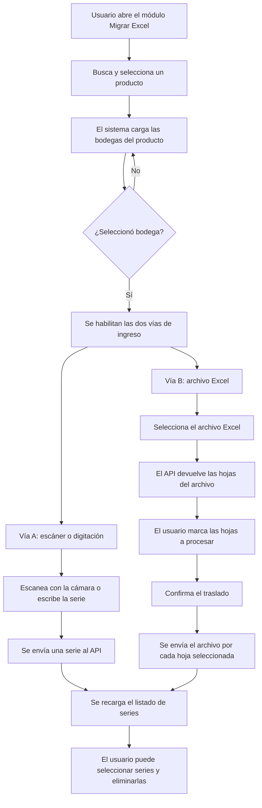

# Requerimiento — Ingreso de Series

> Documento 1 de 4.
> - `01_Requerimiento_Ingreso_Series.md` — **este documento** (qué se pide y por qué).
> - `02_Flujo_Flutter_Migrar_Excel.md` — implementación en la aplicación móvil.
> - `03_Flujo_Angular_Migrar_Excel.md` — implementación en la aplicación móvil.
> - `04_Endpoints_Api_Series.md` — contrato del API y procedimientos almacenados.

---

## 1. Objetivo

Permitir que un usuario registre **números de serie** de un producto en una bodega determinada, usando dos vías intercambiables dentro de la misma pantalla:

1. **Carga masiva desde un archivo Excel** — el usuario sube un `.xlsx` que contiene únicamente el listado de series.
2. **Ingreso unitario por escáner o teclado** — el usuario escanea el código de barras / QR de la serie con la cámara del dispositivo / QR de la serie con escáner físico, o lo escribe manualmente.

Ambas vías terminan escribiendo en la misma tabla de series, a través del mismo procedimiento almacenado, con los mismos parámetros de contexto (producto, unidad de medida, bodega, usuario).

## 2. Alcance

### Dentro del alcance

| Capacidad | Descripción |
|---|---|
| Selección de contexto | El usuario busca y selecciona un **producto**; el producto define su **unidad de medida**; luego selecciona una **bodega** de las disponibles para ese producto. |
| Carga masiva | Subida de un archivo Excel, detección de sus hojas, selección de una o varias hojas e inserción de todas las series contenidas. |
| Ingreso unitario | Escaneo con cámara (código de barras / QR) o digitación manual de una serie a la vez. |
| Consulta | Listado paginado de las series registradas, con su fecha y hora de registro. |
| Eliminación | Selección múltiple de series del listado y borrado en lote. |
| Validación de formato | Rechazo del archivo cuando el encabezado no corresponde, cuando hay columnas adicionales o cuando hay celdas vacías. |

### Fuera del alcance

- Creación o mantenimiento de productos, unidades de medida y bodegas (se consumen de un servicio existente).
- Movimientos de inventario, kardex o documentos asociados a la serie.
- Edición de una serie ya registrada (el flujo soportado es eliminar y volver a ingresar).
- Carga de archivos en formato CSV o de texto plano.

## 3. Actores

| Actor | Rol |
|---|---|
| Usuario operativo (bodega / inventario) | Ejecuta el ingreso de series desde la aplicación móvil. |
| API de negocio (GD02) | Valida el archivo, ejecuta el procedimiento almacenado y devuelve el resultado. |
| API de productos (GD01) | Provee el catálogo de productos y las bodegas asociadas a cada producto. |
| Base de datos SQL Server | Persiste las series mediante el procedimiento almacenado `paInsertTblSerie`. |

## 4. Formato del archivo Excel

Este es el punto crítico del requerimiento: **el archivo debe tener una sola columna**.

```
     A
1  Series          ← encabezado, obligatorio, en la celda A1
2  SN-0000001      ← primera serie
3  SN-0000002
4  SN-0000003
…  …
```

### Reglas del archivo

| Regla | Detalle |
|---|---|
| Encabezado | Debe estar en la **fila 1**. El nombre aceptado es `Series` o `Serie`. |
| Sensibilidad | El nombre del encabezado **no distingue mayúsculas/minúsculas ni acentos** (`SERIES`, `series`, `Séries` se aceptan por igual). |
| Exclusividad | Debe existir **exactamente uno** de los dos nombres. Si el archivo trae `Serie` **y** `Series` a la vez, o no trae ninguno, se rechaza. |
| Columnas adicionales | **No se permiten.** Cualquier otra columna con encabezado provoca el rechazo del archivo, indicando la letra de la columna sobrante (por ejemplo `B, C`). |
| Datos | Comienzan en la **fila 2** y se leen hasta la última fila con contenido de la hoja. |
| Celdas vacías | Una celda vacía dentro del rango de datos **aborta toda la carga** e informa la fila y la columna afectada. |
| Espacios | Los espacios al inicio y al final de cada valor se recortan automáticamente. |
| Hojas | El archivo puede tener varias hojas. El usuario elige cuáles procesar; cada hoja seleccionada se envía como una petición independiente. |
| Extensiones | `.xls`, `.xlsx`, `.xlsm`. |

### Ejemplo válido

| Series |
|---|
| ABC123456789 |
| ABC123456790 |
| ABC123456791 |

### Ejemplos inválidos

| Caso | Motivo del rechazo |
|---|---|
| Encabezado `Numero_Serie` en A1 | El nombre no es `serie` ni `series`. |
| Columnas `Series` (A) y `Cantidad` (B) | Columna adicional detectada en la posición `B`. |
| Columnas `Serie` (A) y `Series` (B) | Existen ambos nombres simultáneamente. |
| Encabezado en A3 en vez de A1 | Los encabezados se leen siempre de la fila 1. |
| Fila 5 vacía entre datos | Valor vacío; se aborta y se reporta `Fila 5, Columna A: Valor vacío.` |

## 5. Flujo funcional



### Precondiciones

1. El usuario tiene sesión activa y token válido tanto para el API de negocio (GD02) como para el API de productos (GD01).
2. El usuario tiene una **empresa** y una **estación de trabajo** seleccionadas (se usan como filtro al buscar productos y bodegas).
3. **La bodega debe estar seleccionada antes de poder escanear o subir el archivo.** Mientras no haya bodega, el campo de escaneo y el cargador de Excel permanecen ocultos.

### Postcondiciones

- Cada serie procesada queda registrada asociada al trío `producto` + `unidad de medida` + `bodega`, junto con el usuario que la registró y la marca de tiempo.
- El listado en pantalla se refresca automáticamente tras cada operación exitosa (alta o baja).

## 6. Reglas de negocio

| # | Regla |
|---|---|
| RN-01 | La unidad de medida **no se selecciona manualmente**: se deriva del producto elegido. |
| RN-02 | Las bodegas ofrecidas son solo las que corresponden al producto y unidad de medida seleccionados. |
| RN-03 | Cambiar de bodega limpia el archivo cargado y la selección de hojas, para evitar que un archivo se envíe con un contexto distinto al que el usuario vio. |
| RN-04 | La carga desde Excel es **transaccional por hoja**: si una sola serie de la hoja falla al insertarse, se revierte la hoja completa. |
| RN-05 | Si se seleccionan varias hojas, cada hoja es una transacción independiente; una hoja puede tener éxito y otra fallar. |
| RN-06 | Las validaciones de formato del archivo se ejecutan **antes** de abrir la transacción; ninguna serie se inserta si el archivo no pasa la validación. |
| RN-07 | Una serie vacía o compuesta solo de espacios nunca se inserta. |
| RN-08 | La eliminación se hace serie por serie; el listado se recarga una sola vez al terminar el lote. |

## 7. Criterios de aceptación

| # | Criterio |
|---|---|
| CA-01 | Con producto y bodega seleccionados, al subir un Excel con la columna `Series` en A1 y N series, quedan registradas las N series. |
| CA-02 | Al subir un archivo con una columna adicional, el sistema no inserta nada y muestra la letra de la columna sobrante. |
| CA-03 | Al subir un archivo con una celda vacía intermedia, el sistema no inserta nada y muestra el número de fila. |
| CA-04 | Al escanear un código con la cámara, la serie queda registrada y el listado se refresca sin salir de la pantalla. |
| CA-05 | Al escribir una serie y confirmar, el comportamiento es idéntico al del escáner. |
| CA-06 | El listado muestra la serie y su fecha/hora de registro. |
| CA-07 | Al marcar varias series y presionar eliminar, todas desaparecen del listado. |
| CA-08 | Sin bodega seleccionada, no es posible escanear ni subir archivo. |
| CA-09 | Todo error del API se presenta al usuario en un diálogo legible, sin cerrar la pantalla ni perder el contexto seleccionado. |

## 8. Casos de error y mensajes

| Situación | Origen | Mensaje al usuario |
|---|---|---|
| No se seleccionó archivo al pulsar trasladar | Aplicación | «No se ha seleccionado un archivo» |
| Encabezado incorrecto o ambiguo | API | «Las columnas del archivo Excel no coinciden.» / «Debe contener la columna 'serie' o 'series', pero no ambas al mismo tiempo.» |
| Columnas adicionales | API | «El archivo Excel contiene columnas no permitidas.» + posiciones detectadas |
| Celda vacía | API | «Se encontraron errores en el archivo Excel.» + `Fila N, Columna X: Valor vacío.` |
| Serie vacía en ingreso unitario | API | «El campo 'serie' no puede estar vacío.» |
| Error de base de datos | API | «Operación fallida» + mensaje del motor SQL |
| Sin conexión / servidor inalcanzable | Aplicación | Mensaje de error de red, con opción de reintentar |
| Sesión expirada | Aplicación | Aviso de sesión expirada y retorno a la pantalla de inicio |

## 9. Glosario

| Término | Significado |
|---|---|
| **Serie** | Identificador único de una unidad física de un producto (número de serie / IMEI / código impreso). |
| **Producto** | Artículo del catálogo de inventario. Se identifica por un código numérico. |
| **Unidad de medida** | Unidad en la que se maneja el producto. Se deriva del producto, no se elige aparte. |
| **Bodega** | Ubicación física de almacenamiento donde queda registrada la serie. |
| **Hoja** | Pestaña dentro del archivo Excel. Un archivo puede tener varias y el usuario elige cuáles procesar. |
| **Traslado de datos** | Nombre que la interfaz da a la operación de leer el Excel e insertar sus series. |
| **TAccion** | Parámetro numérico que indica al procedimiento almacenado qué operación ejecutar (1 insertar, 2 consultar, 3 eliminar). |
