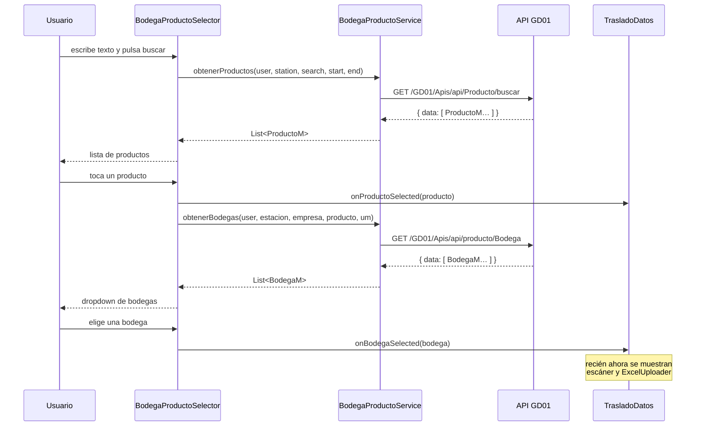
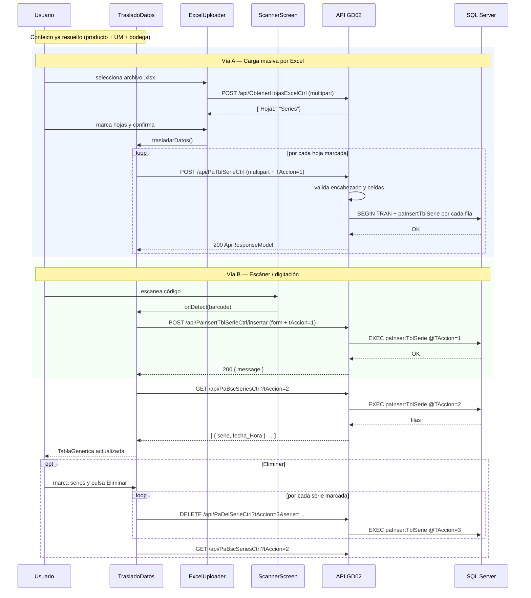

# Flujo en Flutter — Módulo `migrar_excel`

> Documento 2 de 3.
> - `01_Requerimiento_Ingreso_Series.md` — qué se pide y por qué.
> - `02_Flujo_Flutter_Migrar_Excel.md` — **este documento** (implementación en la aplicación móvil).
> - `03_Endpoints_Api_Series.md` — contrato del API y procedimientos almacenados.

---

## 1. Ubicación y forma del módulo

El módulo **no es una aplicación independiente**: es un *paquete Flutter local* (`package:migrar_excel`) que la aplicación `business` consume como dependencia por ruta.

```
GD02_APPMOVIL/business/
├── pubspec.yaml                       # declara la dependencia por path
├── lib/
│   ├── main.dart                      # registra MigrarExcelNotifier en el árbol de Providers
│   ├── widgets/layout.dart            # navega al módulo según displayURLAlter
│   └── shared/                        # widgets, modelos y servicios COMPARTIDOS que el módulo usa
│       ├── models/productos/producto_m.dart
│       ├── models/productos/bodega_m.dart
│       ├── services/bodega_producto_service.dart
│       ├── widgets/forms/bodega_producto_selector.dart
│       ├── widgets/file_upload/excel_uploader.dart
│       └── widgets/structures/data_table_source.dart      (TablaGenerica)
├── core/                              # paquete base: notifiers, servicios y componentes transversales
│   └── lib/
│       ├── components/ScannerScreen.dart
│       ├── models/PaTblSerieM.dart
│       ├── common/UrlNotifier.dart
│       └── services/login_service.dart
└── features/procesos/migrar_excel/    # EL MÓDULO
    ├── pubspec.yaml
    └── lib/
        ├── migrar_excel.dart          # barrel: exporta Layout
        ├── common/MigrarExcelNotifier.dart
        ├── common/UrlNotifier.dart
        ├── components/Layout.dart     # cascarón: AppBar, Drawer, Footer, SpeedDial
        └── components/trasladoDatos.dart   ← TODA LA LÓGICA DE SERIES VIVE AQUÍ
```

Vale la pena subrayar la separación: el módulo `migrar_excel` aporta el **cascarón y la orquestación**; los componentes reutilizables (selector de bodega/producto, cargador de Excel, tabla genérica, escáner) viven en `business/lib/shared` y en `core`, y son compartidos con otros módulos del sistema.

### Cómo se engancha en la aplicación

**`business/pubspec.yaml`** — dependencia por ruta:

```yaml
dependencies:
  migrar_excel:
    path: ./features/procesos/migrar_excel
```

**`business/lib/main.dart`** — el notifier del módulo se registra globalmente:

```dart
import 'package:migrar_excel/common/MigrarExcelNotifier.dart';
...
ChangeNotifierProvider(create: (context) => MigrarExcelNotifier()),
```

**`business/lib/widgets/layout.dart`** — la navegación es por *código de display*, no por ruta nombrada. El backend devuelve el `displayURLAlter` del menú y el `switch` decide qué módulo abrir:

```dart
import 'package:migrar_excel/migrar_excel.dart' as migrar_excel;
...
switch (_selectedUserDisplay!.displayURLAlter) {
  case "prcMigrarExcel":
    Navigator.push(context, MaterialPageRoute(
      builder: (context) => migrar_excel.Layout(
        imagePath: ..., isBackgroundSet: ..., temaClaro: ...,
        token: widget.token,                        // token GD02
        pUserName: widget.userController.text,      // usuario de la sesión
        fechaSesion: DateTime.now(),
        fechaExpiracion: widget.fechaExpiracion,
        pApplication: aplicacionesNotifier.selectedApplication!.application,
        userController: widget.userController,
      ),
    ));
    break;
```

> El código de menú que activa este módulo es **`prcMigrarExcel`**.

## 2. Bibliotecas utilizadas

Declaradas en `features/procesos/migrar_excel/pubspec.yaml` (y replicadas en `core` / `business` donde corresponde).

| Paquete | Versión | Para qué se usa en este flujo |
|---|---|---|
| **`dio`** | `^5.7.0` | Cliente HTTP de todas las llamadas al API GD02. Se usa por su soporte de `FormData` / `MultipartFile`, necesario para enviar el archivo Excel, y por `DioException`, que da acceso al cuerpo de la respuesta de error. |
| **`file_picker`** | `10.1.9` | Abre el selector de archivos del sistema operativo, filtrado a `xls`, `xlsx`, `xlsm`. Devuelve un `PlatformFile` con `path`, `name`, `size` y `bytes`. |
| **`mobile_scanner`** | `^7.0.0` | Lectura de códigos de barras y QR con la cámara. Se usa a través del widget `MobileScanner` dentro de `ScannerScreen`. |
| **`provider`** | `^6.1.2` | Inyección de dependencias y estado compartido: `UrlNotifier` (URL base configurable), `ThemeNotifier` (tema claro/oscuro), `EmpresaNotifier`, `EstacionTrabajoNotifier`, `MigrarExcelNotifier`, `AccionService`. |
| **`http`** | — | Usado únicamente por `BodegaProductoService` para hablar con el API GD01 (productos y bodegas). Convive con `dio`; la razón es que ese servicio compartido ya existía con `http`. |
| **`intl`** / **`intl_utils`** | `^0.20.2` / `^2.8.7` | Internacionalización. Los textos de la pantalla salen de los `.arb` generados (`business_l10n.S.of(context)` y `l10n_core.S.of(context)`); también se usa `NumberFormat` para mostrar el tamaño del archivo en KB. |
| **`material_design_icons_flutter`** | `^7.0.7296` | Iconografía (`MdiIcons.fileExcel`, `MdiIcons.checkboxMarkedCircle`, `MdiIcons.database`…). |
| **`font_awesome_flutter`** | `^10.8.0` | Iconos de los diálogos de confirmación y error. |
| **`flutter_speed_dial`** | `^7.0.0` | Botón flotante expandible del `Layout` (accesos a configuración de base de datos y de URL). |
| **`dropdown_button2`** | `^2.3.9` | Dropdowns estilizados en formularios compartidos. |
| **`shared_preferences`** | — | (vía `core/services/login_service.dart`) almacena los tokens `token` (GD02) y `tokenGD01`, y la fecha de expiración de sesión. |

### Permiso requerido

Para el escáner, `android/app/src/main/AndroidManifest.xml` declara:

```xml
<uses-permission android:name="android.permission.CAMERA"/>
```

## 3. Árbol de widgets

```
migrar_excel.Layout                       (features/procesos/migrar_excel/lib/components/Layout.dart)
├── DrawerPersonalizado                   (business/shared/widgets/layout/drawer.dart)
├── CustomScrollView
│   ├── CustomSliverAppBar                (título dinámico vía AccionService)
│   └── TrasladoDatos                     ← PANTALLA PRINCIPAL DEL FLUJO
│       └── AppBodyContainer
│           ├── ExpansionTile "Seleccionar archivo Excel"
│           │   ├── BodegaProductoSelector      (business/shared/widgets/forms/)
│           │   │   ├── TextField de búsqueda de producto
│           │   │   ├── ListView de resultados
│           │   │   └── DropdownButton<BodegaM> de bodegas
│           │   └── [visible solo si hay bodega seleccionada]
│           │       ├── TextField "Serie escaneada o ingresada"
│           │       │   ├── prefixIcon → ScannerScreen  (core/components/)
│           │       │   └── suffixIcon → enviar serie
│           │       └── ExcelUploader                    (business/shared/widgets/file_upload/)
│           │           ├── Card de selección / archivo cargado
│           │           ├── CheckboxListTile por cada hoja del libro
│           │           └── Botón "Trasladar datos" → diálogo de confirmación
│           ├── Botón "Eliminar" (visible si hay series marcadas)
│           └── TablaGenerica<PaTblSerieM>               (business/shared/widgets/structures/)
├── Footer
└── SpeedDial (configurar base de datos / configurar URL)
```

## 4. Estado de `_TrasladoDatosState`

Todo el flujo se maneja con `setState` sobre un `StatefulWidget`; no hay bloc ni notifier dedicado a las series.

| Campo | Tipo | Rol |
|---|---|---|
| `_productoSeleccionado` | `ProductoM?` | Producto elegido. Aporta `producto` y `unidadMedida`. |
| `_bodegaSeleccionada` | `BodegaM?` | Bodega elegida. **Actúa de compuerta:** mientras sea `null`, el escáner y el cargador de Excel no se renderizan. |
| `_archivoSeleccionado` | `PlatformFile?` | Archivo Excel cargado. |
| `_nombresHojas` | `List<String>` | Hojas que el API detectó en el libro. |
| `_nombresHojasSeleccionadas` | `List<String>` | Hojas que el usuario marcó para procesar. |
| `_series` | `List<PaTblSerieM>` | Listado que alimenta la tabla. |
| `_seriesSeleccionadas` | `List<String>` | Series marcadas con checkbox para eliminar. |
| `_serieController` | `TextEditingController` | Texto del campo de serie manual/escaneada. |
| `_focusSerie` | `FocusNode` | Foco del campo de serie. |
| `_cargandoTraslado` | `bool` | Indicador de carga para traslado, consulta, alta unitaria y eliminación. |
| `_cargandoHojas` | `bool` | Indicador de carga mientras el API lee las hojas del libro. |
| `_dio` | `Dio` | Cliente HTTP de la pantalla. |

## 5. Las cuatro operaciones

Todas viven en `features/procesos/migrar_excel/lib/components/trasladoDatos.dart` y comparten el mismo patrón: activar el indicador de carga → llamar al API → mostrar mensaje → refrescar el listado → apagar el indicador en el `finally`.

### 5.1 `_trasladarDatos()` — carga masiva desde Excel

```dart
for (String hojaSeleccionada in _nombresHojasSeleccionadas) {
  FormData formData = FormData.fromMap({
    'ArchivoExcel'    : await dio.MultipartFile.fromFile(selectedFile.path!,
                                                         filename: selectedFile.name),
    'NombreHojaExcel' : hojaSeleccionada,
    'TAccion'         : 1,
    'pUserName'       : widget.pUserName,
    'pProducto'       : _productoSeleccionado!.producto,
    'pBodega'         : _bodegaSeleccionada!.bodega,
    'pUnidad_Medida'  : _productoSeleccionado!.unidadMedida,
  });

  final response = await _dio.post(
    '${urlNotifier.url}GD02/Apis/api/PaTblSerieCtrl',
    data: formData,
    options: Options(headers: {"Authorization": "Bearer ${widget.token}"}),
  );
}
```

Puntos a destacar:

- **Una petición por hoja seleccionada.** El archivo completo se vuelve a subir en cada iteración; el parámetro `NombreHojaExcel` le dice al API cuál hoja leer.
- Si no hay archivo cargado, se muestra el diálogo `_msgSeleccionarArchivo()` y no se llama al API.
- Al terminar (con éxito o error) se limpia `_nombresHojasSeleccionadas`, para forzar al usuario a volver a marcar las hojas si quiere repetir la carga.
- Tras cada respuesta `200` se llama `_obtenerSeries()` para refrescar la tabla.

### 5.2 `_ingresarSerie(String serie)` — alta unitaria (escáner o teclado)

```dart
FormData formData = FormData.fromMap({
  'tAccion'      : 1,
  'serie'        : serie,
  'bodega'       : _bodegaSeleccionada!.bodega,
  'producto'     : _productoSeleccionado!.producto,
  'unidadMedida' : _productoSeleccionado!.unidadMedida,
  'userName'     : widget.pUserName,
});

final response = await _dio.post(
  '${urlNotifier.url}GD02/Apis/api/PaInsertTblSerieCtrl/insertar',
  data: formData,
  options: Options(headers: {"Authorization": "Bearer ${widget.token}"}),
);
```

Se dispara desde **tres puntos de entrada**, todos hacia el mismo método:

| Punto de entrada | Código |
|---|---|
| Icono de QR (`prefixIcon`) | Abre `ScannerScreen`; el callback `onDetect` llama `_ingresarSerie(barcode)` y cierra la pantalla del escáner. |
| Icono de enviar (`suffixIcon`) | Visible solo si el campo tiene texto; llama `_ingresarSerie(_serieController.text)`. |
| Tecla de envío del teclado | `onSubmitted: (value) { if (value.isNotEmpty) _ingresarSerie(value); }` |

Al finalizar se ejecuta `_serieController.clear()`, dejando el campo listo para el siguiente escaneo — es lo que permite escanear en ráfaga sin tocar la pantalla.

> Nota: al usar el escáner, el `FocusScope.of(context).unfocus()` previo evita que el teclado virtual quede abierto sobre la vista de cámara.

### 5.3 `_obtenerSeries()` — consulta del listado

```dart
final response = await _dio.get(
  '${urlNotifier.url}GD02/Apis/api/PaBscSeriesCtrl?tAccion=2',
  options: Options(headers: {"Authorization": "Bearer ${widget.token}"}),
);

_series = (response.data as List).map((item) => PaTblSerieM.fromJson(item)).toList();
```

La respuesta es un arreglo plano (no viene envuelto en `ApiResponseModel`), por eso el `map` directo sobre `response.data`.

> Este método **no se invoca en `initState`**: la tabla aparece vacía al entrar y se puebla después de la primera alta o baja. Es un comportamiento consciente del diseño actual.

### 5.4 `_eliminarSeries(List<String> series)` — baja en lote

```dart
for (String serie in series) {
  await _dio.delete(
    '${urlNotifier.url}GD02/Apis/api/PaDelSerieCtrl?tAccion=3&serie=$serie',
    options: Options(headers: {"Authorization": "Bearer ${widget.token}"}),
  );
}
_seriesSeleccionadas.clear();
_obtenerSeries();
```

Es un bucle de peticiones `DELETE` individuales; no existe un endpoint de borrado masivo. La tabla se recarga una sola vez, al final del bucle.

## 6. Selección de producto y bodega — `BodegaProductoSelector`

Widget compartido (`business/lib/shared/widgets/forms/bodega_producto_selector.dart`) que resuelve el contexto obligatorio antes de poder ingresar series. Habla con el **API GD01**, no con GD02, a través de `BodegaProductoService`, y usa un token distinto (`getTokenGD01`).



Detalle importante: **los parámetros del API GD01 viajan como cabeceras HTTP**, no como query string ni body:

```dart
headers: {
  "Content-Type" : "application/json",
  "Authorization": "Bearer $token",
  "user"         : user,
  "station"      : station,
  "search"       : search,
  "start"        : start.toString(),
  "end"          : end.toString(),
}
```

Y en el lado de `TrasladoDatos`, el callback de bodega hace una limpieza deliberada para no mezclar contextos:

```dart
onBodegaSelected: (bodegaSeleccionada) {
  setState(() {
    _bodegaSeleccionada = bodegaSeleccionada;
    _nombresHojas.clear();
    _nombresHojasSeleccionadas = [];
    _archivoSeleccionado = null;      // el archivo se descarta al cambiar de bodega
  });
},
```

## 7. Carga del archivo — `ExcelUploader`

Widget compartido (`business/lib/shared/widgets/file_upload/excel_uploader.dart`), reutilizado por todos los módulos de migración. Es un componente **controlado**: no guarda el archivo ni las hojas, los recibe por parámetro y los devuelve por callback.

### Selección del archivo

```dart
FilePickerResult? result = await FilePicker.platform.pickFiles(
  type: FileType.custom,
  allowedExtensions: ['xls', 'xlsx', 'xlsm'],
  withData: true,          // necesario para tener archivo.bytes
);
```

### Descubrimiento de hojas

Inmediatamente después de seleccionar el archivo, el widget lo envía al API para saber qué hojas contiene:

```dart
dio.FormData formData = dio.FormData.fromMap({
  'archivoExcel': dio.MultipartFile.fromBytes(file.bytes!, filename: file.name),
});

final response = await _dio.post(
  '${urlNotifier.url}GD02/Apis/api/ObtenerHojasExcelCtrl',
  data: formData,
  options: Options(headers: {"Authorization": "Bearer ${widget.token}"}),
);

final nombres = List<String>.from(response.data);   // ["Hoja1", "Series", …]
widget.setNombresHojas(nombres);
```

### Confirmación

El botón «Trasladar datos» aparece solo cuando hay archivo **y** al menos una hoja marcada. Abre un diálogo de confirmación que lista las hojas seleccionadas y, al aceptar, ejecuta el callback `trasladarDatos` (que en este módulo es `_trasladarDatos`).

> El widget soporta además un callback opcional `eliminarDatos`, que agrega al diálogo un checkbox «Eliminar data antes de trasladar». **El módulo de series no lo usa** (`eliminarDatos` no se pasa), por lo que el diálogo mostrado es el simple.

## 8. Escaneo — `ScannerScreen`

Componente mínimo en `core/lib/components/ScannerScreen.dart`:

```dart
class ScannerScreen extends StatelessWidget {
  final Function(String) onDetect;

  @override
  Widget build(BuildContext context) {
    return Scaffold(
      appBar: AppBar(title: Text("Escanear código")),
      body: MobileScanner(
        onDetect: (capture) {
          final barcode = capture.barcodes.first.rawValue;
          if (barcode != null) onDetect(barcode);
        },
      ),
    );
  }
}
```

Toma la **primera** lectura de cada captura (`capture.barcodes.first`) y la entrega en crudo (`rawValue`) al callback. Toda la lógica de qué hacer con el código vive en el llamador; el escáner no conoce el dominio de series.

En `TrasladoDatos`, el callback inserta la serie y luego cierra la pantalla del escáner:

```dart
onDetect: (barcode) async {
  await _ingresarSerie(barcode);
  Navigator.of(context).pop();
},
```

## 9. Presentación del listado — `TablaGenerica<PaTblSerieM>`

```dart
TablaGenerica<PaTblSerieM>(
  data: _series,
  themeNotifier: themeNotifier,
  height: 400,
  toJsonMap: (item) => {
    'Serie'      : item.serie,
    'Fecha_Hora' : item.fechaHora.toString(),
  },
  leadingColumnTitle: 'Sel',
  leadingCellBuilder: (item) => Checkbox(
    value: _seriesSeleccionadas.contains(item.serie),
    onChanged: (selected) => setState(() {
      selected == true
        ? _seriesSeleccionadas.add(item.serie)
        : _seriesSeleccionadas.remove(item.serie);
    }),
  ),
)
```

La tabla es genérica: deriva sus columnas del `Map<String,String>` que devuelve `toJsonMap`, y admite una columna inicial personalizada (`leadingCellBuilder`) que aquí se usa para el checkbox de selección. Incluye paginación propia.

El botón «Eliminar» se renderiza **solo** cuando `_seriesSeleccionadas` no está vacía.

## 10. Modelos de datos

| Modelo | Archivo | Campos |
|---|---|---|
| `ProductoM` | `business/lib/shared/models/productos/producto_m.dart` | `id`, `producto`, `unidadMedida`, `productoId`, `desProducto`, `desUnidadMedida`, `tipoProducto`, `rows` |
| `BodegaM` | `business/lib/shared/models/productos/bodega_m.dart` | `bodega`, `nombre`, `existencia`, `poseeComponente`, `orden` |
| `PaTblSerieM` | `core/lib/models/PaTblSerieM.dart` | `serie`, `fechaHora` |

```dart
class PaTblSerieM {
  final String serie;
  final DateTime fechaHora;

  factory PaTblSerieM.fromJson(Map<String, dynamic> json) => PaTblSerieM(
        serie: json['serie'],
        fechaHora: DateTime.parse(json['fecha_Hora']),
      );
}
```

> El JSON del API llega en *camelCase con guion bajo* (`fecha_Hora`) porque es la serialización por defecto de ASP.NET Core sobre la propiedad C# `Fecha_Hora`.

## 11. Autenticación y URL base

| Aspecto | Implementación |
|---|---|
| **URL base** | `UrlNotifier` (Provider). Es configurable en tiempo de ejecución desde el `SpeedDial` del `Layout` («Configurar URL»). Todas las llamadas se construyen como `'${urlNotifier.url}GD02/Apis/api/…'`. |
| **Token GD02** | Llega como parámetro `widget.token` desde el `Layout` de la aplicación y se envía en la cabecera `Authorization: Bearer …`. |
| **Token GD01** | Se obtiene aparte con `LoginService().getTokenGD01(context)`, que lo lee de `SharedPreferences` (`tokenGD01`). |
| **Expiración** | `LoginService._validateToken` compara contra `tokenExpiration` en `SharedPreferences`. Si venció: limpia la sesión, activa `tokenExpiredNotifier`, muestra un `SnackBar` y navega a `/inicio` eliminando el stack. |

## 12. Manejo de errores

El patrón, repetido en las cuatro operaciones:

```dart
catch (e) {
  if (e is DioException) {
    if (e.response != null) {
      mostrarDialogoError(context: context,
                          respuestaError: jsonEncode(e.response?.data));
    } else {
      mostrarDialogoError(context: context, respuestaError: e.message ?? '');
    }
  } else {
    if (mounted) {
      mostrarDialogoError(context: context, respuestaError: e.toString());
    }
  }
} finally {
  setState(() { _cargandoTraslado = false; });
}
```

- **`DioException` con `response`** → error devuelto por el API; se muestra el cuerpo completo (que incluye `Message`, `Error`, `StoredProcedure` y `Parameters` del `ApiResponseModel`).
- **`DioException` sin `response`** → error de red; se muestra `e.message`.
- **Cualquier otra excepción** → se muestra `e.toString()`.
- En `_obtenerSeries` y `_eliminarSeries`, `mostrarDialogoError` recibe además `funcionPrimerBoton`, que **reintenta** la consulta.
- El éxito se comunica con `mostrarMensajeScaffold` (SnackBar verde con `MdiIcons.checkboxMarkedCircle`, 2 segundos).
- Todos los bloques verifican `mounted` antes de tocar el `context`, porque las respuestas pueden llegar después de que el usuario abandonó la pantalla.

## 13. Diagrama de secuencia completo



## 14. Observaciones técnicas del estado actual

Puntos que conviene conocer al mantener o extender el módulo:

| # | Observación |
|---|---|
| 1 | **`_obtenerSeries()` no se llama en `initState`.** La tabla parte vacía; solo se llena tras el primer alta o baja. Si se quiere mostrar el histórico al entrar, hay que invocarlo desde `initState`. |
| 2 | **El listado no se filtra por producto/bodega.** `PaBscSeriesCtrl` se llama solo con `tAccion=2`; el procedimiento decide qué devuelve. La tabla no está acotada al contexto seleccionado en pantalla. |
| 3 | **`_trasladarDatos` usa `MultipartFile.fromFile(path)`** mientras que `ExcelUploader._obtenerHojasExcel` usa `MultipartFile.fromBytes(bytes)`. La variante por `path` no funciona en Flutter Web (donde `PlatformFile.path` es `null`); la variante por `bytes` sí. Es una diferencia a considerar si el módulo se despliega a web. |
| 4 | **El archivo se re-sube por cada hoja seleccionada.** Con libros grandes y varias hojas esto multiplica el tráfico. |
| 5 | **La eliminación es N peticiones.** No hay endpoint de borrado en lote. |
| 6 | **`MigrarExcelNotifier`** (`mostrarHistorial`, `cambiarVista`) está registrado y consumido con `Consumer` en el `Layout`, pero sus banderas no gobiernan hoy ninguna rama de la interfaz de series. |
| 7 | **Textos parcialmente internacionalizados.** La mayoría sale de los `.arb`, pero algunos están fijos en el código: `"Serie escaneada o ingresada"`, `"Escanea o escribe una serie..."`, `"Ingresado Correctamente"`, `"Escanear código"`, `"Sel"`. |
| 8 | **`WillPopScope`** está deprecado en versiones recientes de Flutter; el `Layout` aún lo usa (`utils.onWillPop`). |
| 9 | **Se conviven dos clientes HTTP:** `dio` para GD02 y `http` para GD01. Es intencional por reutilización de `BodegaProductoService`, pero implica dos rutas distintas de manejo de errores. |
