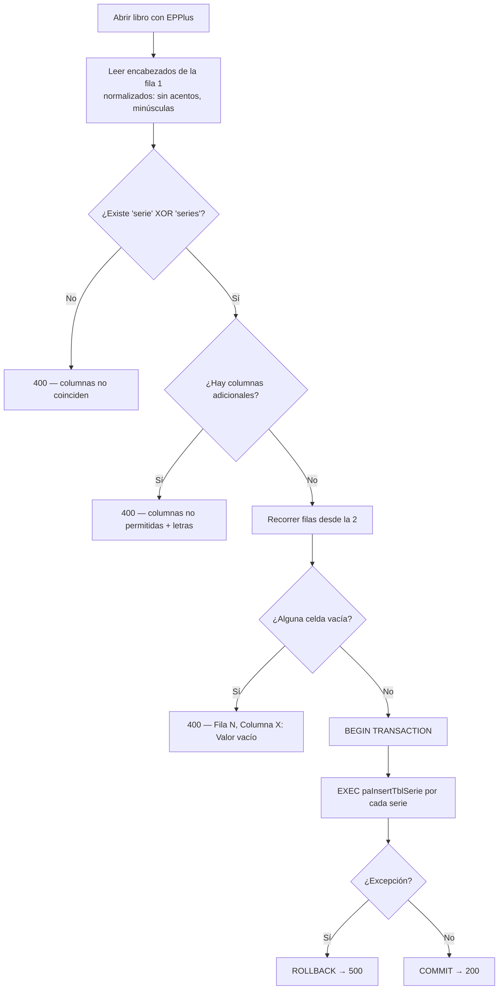
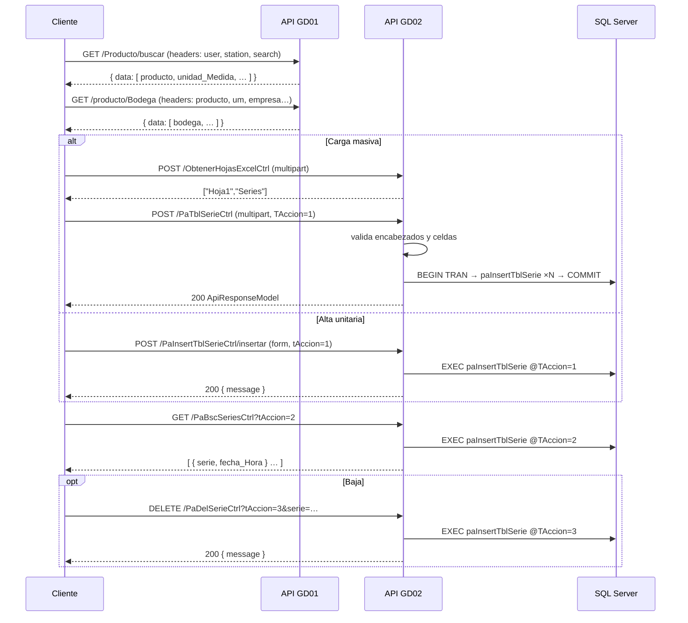

# Endpoints del API — Ingreso de Series

> Documento 3 de 3.
> - `01_Requerimiento_Ingreso_Series.md` — qué se pide y por qué.
> - `02_Flujo_Flutter_Migrar_Excel.md` — implementación en la aplicación móvil.
> - `03_Endpoints_Api_Series.md` — **este documento** (contrato del API y procedimientos almacenados).

---

## 1. Resumen

El flujo consume **dos APIs distintas**:

| API | Prefijo de ruta | Responsabilidad en este flujo |
|---|---|---|
| **GD02 — `ApiBusiness`** (ASP.NET Core 8) | `{baseUrl}GD02/Apis/api/…` | Lectura del Excel, validación de formato y alta / consulta / baja de series. |
| **GD01 — API de productos** | `{baseUrl}GD01/Apis/api/…` | Catálogo de productos y bodegas asociadas. Se documenta aquí desde la perspectiva del consumidor; su implementación vive en otro repositorio. |

### Tabla de endpoints

| # | Método | Ruta | Controlador | SP que consume | Uso |
|---|---|---|---|---|---|
| 1 | `GET` | `/GD01/Apis/api/Producto/buscar` | *(GD01)* | — | Buscar productos |
| 2 | `GET` | `/GD01/Apis/api/producto/Bodega` | *(GD01)* | — | Bodegas del producto |
| 3 | `POST` | `/GD02/Apis/api/ObtenerHojasExcelCtrl` | `ObtenerHojasExcelCtrl` | — | Listar hojas del libro |
| 4 | `POST` | `/GD02/Apis/api/PaTblSerieCtrl` | `PaTblSerieCtrl` | `paInsertTblSerie` | Carga masiva desde Excel — **en desuso** |
| 5 | `POST` | `/GD02/Apis/api/PaInsertTblSerieCtrl/insertar` | `PaInsertTblSerieCtrl` | `paInsertTblSerie` | Alta unitaria (escáner) — **en desuso** |
| 6 | `GET` | `/GD02/Apis/api/PaBscSeriesCtrl` | `PaBscSeriesCtrl` | `paInsertTblSerie` | Consulta de series — **en desuso** |
| 7 | `DELETE` | `/GD02/Apis/api/PaDelSerieCtrl` | `PaDelSerieCtrl` | `paInsertTblSerie` | Baja de una serie — **en desuso** |
| 8 | `POST` | `/GD02/Apis/api/Series/mantenimiento` | `SeriesController` | `PA_tbl_Serie` | Mantenimiento de series — **nuevo, reemplaza a 4–7** |

**Los cuatro endpoints de series (4–7) apuntan al mismo procedimiento almacenado `paInsertTblSerie`**; lo que cambia entre ellos es el valor de `TAccion`.

> ## ⚠️ Cambio 03/11/2026 — `paInsertTblSerie` deja de usarse
>
> **Los endpoints que usan `paInsertTblSerie` (4, 5, 6 y 7) se dejarán de usar**, porque ese procedimiento no cumple con los estándares de la empresa.
> En su lugar se usará **`PA_tbl_Serie`**, el procedimiento estándar de la tabla `tbl_Serie`, a través del endpoint nuevo:
>
> ```http
> POST /GD02/Apis/api/Series/mantenimiento
> ```
>
> | Endpoint que se deja de usar | Se reemplaza con `POST /GD02/Apis/api/Series/mantenimiento` |
> |---|---|
> | `POST /GD02/Apis/api/PaTblSerieCtrl` (carga masiva) | `TAccion = 1`, **una petición por serie** (el endpoint nuevo no recibe Excel) |
> | `POST /GD02/Apis/api/PaInsertTblSerieCtrl/insertar` (alta unitaria) | `TAccion = 1` |
> | `GET /GD02/Apis/api/PaBscSeriesCtrl` (consulta) | `TAccion = 4`, una serie por llave completa (no hay acción para listar todas) |
> | `DELETE /GD02/Apis/api/PaDelSerieCtrl` (baja) | `TAccion = 3`, con llave completa |
>
> **Mientras los clientes (Angular y Flutter) migran**, los endpoints 4–7 siguen funcionando igual, con las mismas rutas, parámetros y respuestas, para no afectar a quien ya los consume.
> El endpoint nuevo **no es un reemplazo directo**: cambia el contrato, y la serie escaneada va en `id_Serie`. Antes de migrar un cliente, revisar las diferencias en la sección 14.

### Ubicación de los archivos en `GD02_APPIS`

```
ApiBusiness/ApiBusiness/
├── Controllers/
│   ├── Shared/ObtenerHojasExcelCtrl.cs
│   ├── MigrarExcel/PaTblSerieCtrl.cs
│   ├── Series/
│   │   ├── PaInsertTblSerieCtrl.cs
│   │   ├── PaBscSeriesCtrl.cs
│   │   └── PaDelSerieCtrl.cs
│   └── Inventario/Mantenimiento/SeriesController.cs            (nuevo — PA_tbl_Serie)
├── Servicios/Inventario/Mantenimiento/SerieService.cs          (nuevo — PA_tbl_Serie)
├── Models/
│   ├── Shared/ApiResponseM.cs                                  (ApiResponseModel<T>)
│   ├── Request/Inventario/Mantenimiento/SerieM.cs              (nuevo — petición)
│   ├── Response/Inventario/Mantenimiento/SerieM.cs             (nuevo — respuesta)
│   └── Response/Contabilidad/Proceso/PaTblSerieM.cs
├── Utilidades/Utilidades.cs                                    (GetEncabezadosExcel, EliminarDiacriticos)
└── Connection/Conexion.cs                                      (cadenaSQL)
```

## 2. Autenticación

Todos los endpoints de series están decorados con `[Authorize]` (JWT bearer). El cliente debe enviar:

```http
Authorization: Bearer {token}
```

Los tokens de GD01 y GD02 son **distintos** y se gestionan por separado en el cliente.

## 3. Envoltura de respuesta — `ApiResponseModel<T>`

Definida en `Models/Shared/ApiResponseM.cs`, namespace `ApiBusiness.Model.Shared`.

```jsonc
{
  "status": true,                    // bool — éxito de la transacción
  "message": "Migración completada con éxito.",
  "error": "",                       // descripción del error, vacío si status = true
  "storedProcedure": "paInsertTblSerie",
  "parameters": {                    // eco de los parámetros, para depuración
    "@pUserName": "usuario1",
    "@pBodega": 3,
    "@pProducto": 15001,
    "@pUnidad_Medida": 1,
    "@NombreHojaExcel": "Series"
  },
  "data": [ /* … */ ],
  "timestamp": "2026-08-25T14:32:10.123+00:00",
  "version": "1.0.0",
  "releaseDate": "2026-08-01T00:00:00+00:00",
  "errorCode": ""                    // "1-<n>" = SQL, "2" = API/lógica, "3" = no controlado
}
```

> **Atención al consumir:** no todos los endpoints de este flujo devuelven la envoltura. `ObtenerHojasExcelCtrl` (éxito), `PaBscSeriesCtrl` (éxito) y los mensajes de confirmación de alta/baja devuelven formas más simples. La envoltura aparece de forma consistente en las **respuestas de error**. El detalle está indicado endpoint por endpoint.

---

## 4. `POST /GD02/Apis/api/ObtenerHojasExcelCtrl`

Devuelve los nombres de las hojas de un libro Excel. Es el paso previo a la carga masiva: el usuario necesita saber qué hojas hay para elegir cuál procesar.

**Archivo:** `Controllers/Shared/ObtenerHojasExcelCtrl.cs`
**Autorización:** `[Authorize]`
**Content-Type:** `multipart/form-data`

### Petición

| Campo | Tipo | Obligatorio | Descripción |
|---|---|---|---|
| `archivoExcel` | `IFormFile` | Sí | El libro Excel (`.xls`, `.xlsx`, `.xlsm`). |

```http
POST /GD02/Apis/api/ObtenerHojasExcelCtrl HTTP/1.1
Authorization: Bearer {token}
Content-Type: multipart/form-data; boundary=----X

------X
Content-Disposition: form-data; name="archivoExcel"; filename="series.xlsx"
Content-Type: application/vnd.openxmlformats-officedocument.spreadsheetml.sheet

<binario>
------X--
```

### Respuesta `200 OK`

Arreglo plano de cadenas — **sin envoltura**:

```json
["Hoja1", "Series", "Respaldo"]
```

### Respuestas de error

| Código | Cuándo |
|---|---|
| `400` | `ArgumentException` al procesar el libro. |
| `403` | `UnauthorizedAccessException`. |
| `500` | Cualquier otra excepción (archivo corrupto, formato no reconocido por EPPlus…). |

```json
{
  "status": false,
  "message": "Ocurrió un error inesperado al procesar el archivo Excel.",
  "error": "…",
  "storedProcedure": "",
  "parameters": {}
}
```

### Nota de implementación

Usa **EPPlus** y fija la licencia en modo no comercial antes de abrir el libro:

```csharp
ExcelPackage.License.SetNonCommercialOrganization("My Noncommercial organization");
using (var package = new ExcelPackage(request.ArchivoExcel.OpenReadStream()))
{
    foreach (var sheet in package.Workbook.Worksheets)
        nombresHojas.Add(sheet.Name);
    return Ok(nombresHojas);
}
```

---

## 5. `POST /GD02/Apis/api/PaTblSerieCtrl` — carga masiva desde Excel

> **En desuso (03/11/2026).** Usa `paInsertTblSerie`, que no cumple con los estándares de la empresa. Reemplazo: `POST /GD02/Apis/api/Series/mantenimiento` (sección 14).

Es el endpoint central del requerimiento. Recibe el archivo, valida su estructura, arma la lista de series y las inserta **dentro de una transacción**.

**Archivo:** `Controllers/MigrarExcel/PaTblSerieCtrl.cs`
**Método C#:** `MigrarExcel([FromForm] ExcelData request)`
**Autorización:** `[Authorize]`
**Content-Type:** `multipart/form-data`
**SP:** `paInsertTblSerie` (`TAccion = 1`, una ejecución por serie)

### Petición — modelo `ExcelData`

| Campo | Tipo C# | Obligatorio | Descripción |
|---|---|---|---|
| `ArchivoExcel` | `IFormFile` | Sí | El libro Excel. |
| `NombreHojaExcel` | `string` | Sí | Nombre exacto de la hoja a procesar. |
| `TAccion` | `byte` | Sí | `1` = insertar. |
| `pUserName` | `string` | Sí | Usuario que ejecuta la carga. |
| `pProducto` | `int` | Sí | Código del producto. |
| `pUnidad_Medida` | `int` | Sí | Código de la unidad de medida (derivada del producto). |
| `pBodega` | `int` | Sí | Código de la bodega destino. |
| `pCorreoUsuario` | `string?` | No | Correo de notificación. **Actualmente inactivo** — el envío está comentado en el controlador. |

```http
POST /GD02/Apis/api/PaTblSerieCtrl HTTP/1.1
Authorization: Bearer {token}
Content-Type: multipart/form-data; boundary=----X

ArchivoExcel     = <binario series.xlsx>
NombreHojaExcel  = Series
TAccion          = 1
pUserName        = usuario1
pProducto        = 15001
pUnidad_Medida   = 1
pBodega          = 3
```

### Secuencia de validación



#### Detalle de cada validación

**a) Normalización de encabezados** — `Utilidades.GetEncabezadosExcel(worksheet, filaEncabezados: 1)`:
lee la fila 1, descarta celdas vacías, elimina diacríticos y pasa a minúsculas. Por eso `SERIES`, `Series` y `Séries` son equivalentes.

**b) Exclusividad `serie` / `series`** — se exige un XOR estricto:

```csharp
bool tieneSerie  = actualColumnNames.Any(c => c.Equals("serie",  StringComparison.OrdinalIgnoreCase));
bool tieneSeries = actualColumnNames.Any(c => c.Equals("series", StringComparison.OrdinalIgnoreCase));

if (!(tieneSerie ^ tieneSeries))   // ni ambas, ni ninguna
    return BadRequest(...);
```

**c) Columnas adicionales** — cualquier encabezado distinto al aceptado se reporta con su **letra de columna** (`A`, `B`, … `AA`), calculada por el helper privado `ExcelColumnLetter(int)`.

**d) Celdas vacías** — se recorre desde la fila 2 hasta `worksheet.Dimension.Rows`. Toda celda vacía se acumula en `errores`; si al final hay errores, **no se inserta nada**.

**e) Transacción** — una sola transacción para toda la hoja:

```csharp
using (var connection = new SqlConnection(_connectionString))
{
    connection.Open();
    using (var transaction = connection.BeginTransaction())
    {
        try
        {
            foreach (var registro in listaRegistros)
                connection.Execute("paInsertTblSerie", registro, transaction,
                                   commandType: CommandType.StoredProcedure);
            transaction.Commit();
        }
        catch (Exception ex) { transaction.Rollback(); return StatusCode(500, response); }
    }
}
```

Dapper mapea las propiedades de `PaTblSerieParametrosM` a los parámetros del SP por nombre.

### Respuesta `200 OK`

`ApiResponseModel<List<PaTblSerieParametrosM>>` — `data` contiene todas las series efectivamente enviadas al SP:

```json
{
  "status": true,
  "message": "Migración completada con éxito.",
  "error": "",
  "storedProcedure": "paInsertTblSerie",
  "parameters": {
    "@pUserName": "usuario1",
    "@pBodega": 3,
    "@pProducto": 15001,
    "@pUnidad_Medida": 1,
    "@NombreHojaExcel": "Series"
  },
  "data": [
    { "tAccion": 1, "pSerie": "ABC123456789", "pBodega": 3, "pProducto": 15001, "pUnidad_Medida": 1, "pUserName": "usuario1" },
    { "tAccion": 1, "pSerie": "ABC123456790", "pBodega": 3, "pProducto": 15001, "pUnidad_Medida": 1, "pUserName": "usuario1" }
  ],
  "timestamp": "2026-08-25T14:32:10.123+00:00",
  "version": "1.0.0"
}
```

### Respuestas de error

| Código | `message` | `error` |
|---|---|---|
| `400` | `Las columnas del archivo Excel no coinciden.` | `Debe contener la columna 'serie' o 'series', pero no ambas al mismo tiempo.` |
| `400` | `El archivo Excel contiene columnas no permitidas.` | `Se han detectado columnas adicionales en las posiciones: B, C.` |
| `400` | `Se encontraron errores en el archivo Excel.` | `Fila 5, Columna A: Valor vacío. \| Fila 9, Columna A: Valor vacío.` |
| `500` | `Operación fallida` | Mensaje del motor SQL (rollback aplicado). |
| `500` | `Operación fallida` | Excepción general (libro corrupto, hoja inexistente…). |

### Modelos internos

```csharp
public class ExcelData
{
    public IFormFile ArchivoExcel   { get; set; }
    public string    NombreHojaExcel{ get; set; }
    public byte      TAccion        { get; set; }
    public string    pUserName      { get; set; }
    public int       pBodega        { get; set; }
    public int       pProducto      { get; set; }
    public int       pUnidad_Medida { get; set; }
    public string?   pCorreoUsuario { get; set; }
}

public class PaTblSerieParametrosM
{
    public int    TAccion        { get; set; }
    public string pSerie         { get; set; }
    public int    pBodega        { get; set; }
    public int    pProducto      { get; set; }
    public int    pUnidad_Medida { get; set; }
    public string pUserName      { get; set; }
}
```

---

## 6. `POST /GD02/Apis/api/PaInsertTblSerieCtrl/insertar` — alta unitaria

> **En desuso (03/11/2026).** Usa `paInsertTblSerie`, que no cumple con los estándares de la empresa. Reemplazo: `POST /GD02/Apis/api/Series/mantenimiento` (sección 14).

Alta de **una sola serie**. Es el endpoint que atiende el escáner y la digitación manual.

**Archivo:** `Controllers/Series/PaInsertTblSerieCtrl.cs`
**Ruta completa:** `api/PaInsertTblSerieCtrl/insertar` (`[HttpPost("insertar")]`)
**Autorización:** `[Authorize]`
**Content-Type:** `multipart/form-data` o `application/x-www-form-urlencoded` (los parámetros son `[FromForm]`)
**SP:** `paInsertTblSerie` (`TAccion = 1`)

### Petición

| Campo | Tipo C# | Obligatorio | Descripción |
|---|---|---|---|
| `tAccion` | `byte` | Sí | Debe ser `1`. Cualquier otro valor se rechaza. |
| `serie` | `string` | Sí | Número de serie. No puede ser vacío ni solo espacios. |
| `bodega` | `short?` | No¹ | Código de bodega. |
| `producto` | `int?` | No¹ | Código de producto. |
| `unidadMedida` | `byte?` | No¹ | Código de unidad de medida. |
| `userName` | `string` | Sí | Usuario que registra. |

¹ Son nullable en la firma del controlador, pero el cliente siempre los envía y el procedimiento almacenado los requiere para asociar la serie.

> **Ojo con los tipos:** aquí `bodega` es `short?` y `unidadMedida` es `byte?`, mientras que en `PaTblSerieCtrl` ambos son `int`. Es una inconsistencia real entre los dos endpoints; los valores deben caber en el tipo más estrecho.

```http
POST /GD02/Apis/api/PaInsertTblSerieCtrl/insertar HTTP/1.1
Authorization: Bearer {token}
Content-Type: application/x-www-form-urlencoded

tAccion=1&serie=ABC123456789&bodega=3&producto=15001&unidadMedida=1&userName=usuario1
```

### Validaciones previas

```csharp
if (tAccion != 1)
    return BadRequest("Este endpoint solo acepta TAccion = 1 para inserciones.");

if (string.IsNullOrWhiteSpace(serie))
    return StatusCode(500, new ApiResponseModel<List<object>>(...) {
        Status = false, Message = "Operación fallida",
        Error = "El campo 'serie' no puede estar vacío."
    });
```

### Respuesta `200 OK`

Objeto simple, **sin envoltura**:

```json
{ "message": "Serie insertada correctamente." }
```

### Respuestas de error

| Código | Cuerpo |
|---|---|
| `400` | `"Este endpoint solo acepta TAccion = 1 para inserciones."` (texto plano) |
| `500` | `ApiResponseModel` con `Error = "El campo 'serie' no puede estar vacío."` |
| `500` | `ApiResponseModel` con el mensaje de `SqlException` o de la excepción general. |

> La serie vacía devuelve `500` y no `400`, aunque conceptualmente es un error de solicitud. Es el comportamiento actual del controlador.

---

## 7. `GET /GD02/Apis/api/PaBscSeriesCtrl` — consulta de series

> **En desuso (03/11/2026).** Usa `paInsertTblSerie`, que no cumple con los estándares de la empresa. Reemplazo: `POST /GD02/Apis/api/Series/mantenimiento` (sección 14).

**Archivo:** `Controllers/Series/PaBscSeriesCtrl.cs`
**Autorización:** `[Authorize]`
**SP:** `paInsertTblSerie` (`TAccion = 2`)

### Petición

| Parámetro | Ubicación | Tipo | Obligatorio | Descripción |
|---|---|---|---|---|
| `tAccion` | query string | `byte` | Sí | `2` = consultar. |

```http
GET /GD02/Apis/api/PaBscSeriesCtrl?tAccion=2 HTTP/1.1
Authorization: Bearer {token}
```

### Parámetros enviados al SP

El controlador completa el resto de parámetros del procedimiento con `null`, y declara `@pSerie` como parámetro de **salida**:

```csharp
var parameters = new DynamicParameters();
parameters.Add("@TAccion", tAccion);
parameters.Add("@pSerie", dbType: DbType.String, direction: ParameterDirection.Output, size: 50);
parameters.Add("@pBodega",        value: null, dbType: DbType.Int16);
parameters.Add("@pProducto",      value: null, dbType: DbType.Int32);
parameters.Add("@pUnidad_Medida", value: null, dbType: DbType.Byte);
parameters.Add("@pUserName",      value: null, dbType: DbType.String);
```

### Respuesta `200 OK`

Arreglo plano proyectado a dos campos — **sin envoltura**:

```json
[
  { "serie": "ABC123456789", "fecha_Hora": "2026-08-25T09:14:22.000" },
  { "serie": "ABC123456790", "fecha_Hora": "2026-08-25T09:14:35.000" }
]
```

Mapeado en el cliente por `PaTblSerieM.fromJson`.

### Respuestas de error

| Código | Cuándo |
|---|---|
| `400` | `ArgumentException` |
| `403` | `UnauthorizedAccessException` |
| `500` | `SqlException` o excepción general → `ApiResponseModel` con `storedProcedure: "paInsertTblSerie"`. |

> **El endpoint no acepta filtros.** No recibe producto, bodega ni usuario; lo que devuelve depende enteramente de la rama `TAccion = 2` del procedimiento almacenado.

---

## 8. `DELETE /GD02/Apis/api/PaDelSerieCtrl` — baja de una serie

> **En desuso (03/11/2026).** Usa `paInsertTblSerie`, que no cumple con los estándares de la empresa. Reemplazo: `POST /GD02/Apis/api/Series/mantenimiento` (sección 14).

**Archivo:** `Controllers/Series/PaDelSerieCtrl.cs`
**Autorización:** `[Authorize]`
**SP:** `paInsertTblSerie` (`TAccion = 3`)

### Petición

| Parámetro | Ubicación | Tipo | Obligatorio | Descripción |
|---|---|---|---|---|
| `tAccion` | query string | `byte` | Sí | Debe ser `3`. |
| `serie` | query string | `string` | Sí | Serie a eliminar. |

```http
DELETE /GD02/Apis/api/PaDelSerieCtrl?tAccion=3&serie=ABC123456789 HTTP/1.1
Authorization: Bearer {token}
```

### Validación previa

```csharp
if (tAccion != 3)
    return BadRequest("Este endpoint solo acepta TAccion = 3 para eliminar.");
```

### Respuesta `200 OK`

```json
{ "message": "La serie 'ABC123456789' fue eliminada correctamente." }
```

> El mensaje de éxito es **incondicional**: se devuelve aunque el procedimiento no haya encontrado la serie. El endpoint no informa cuántas filas se afectaron.

### Respuestas de error

| Código | Cuándo |
|---|---|
| `400` | `tAccion != 3` (texto plano). |
| `400` | `ArgumentException` |
| `403` | `UnauthorizedAccessException` |
| `500` | `SqlException` o excepción general → `ApiResponseModel`. |

### Elimina de a una

No existe endpoint de borrado en lote. Para eliminar N series, el cliente hace N peticiones `DELETE`.

---

## 9. Procedimiento almacenado `paInsertTblSerie`

> **En desuso (03/11/2026).** No cumple con los estándares de la empresa. Se reemplaza por `PA_tbl_Serie` (sección 14).

Es un procedimiento **multipropósito** con una rama por cada valor de `TAccion`, patrón habitual en esta base de código (`paCrudX(@Accion, …)`).

### Firma (según la usan los cuatro controladores)

| Parámetro | Tipo SQL inferido | Dirección | Notas |
|---|---|---|---|
| `@TAccion` | `tinyint` | Entrada | `1` insertar, `2` consultar, `3` eliminar. |
| `@pSerie` | `varchar(50)` | Entrada / **Salida** en `TAccion = 2` | Número de serie. |
| `@pBodega` | `smallint` | Entrada | Nulo en consulta y baja. |
| `@pProducto` | `int` | Entrada | Nulo en consulta y baja. |
| `@pUnidad_Medida` | `tinyint` | Entrada | Nulo en consulta y baja. |
| `@pUserName` | `varchar` | Entrada | Nulo en consulta y baja. |

> Los tipos están inferidos a partir de las declaraciones `DbType` en los controladores (`DbType.Int16`, `DbType.Int32`, `DbType.Byte`, `DbType.String` con `size: 50`). El script fuente del procedimiento no forma parte de este repositorio.

### Matriz de acciones

| `TAccion` | Operación | Parámetros con valor | Devuelve | Endpoints que la usan |
|---|---|---|---|---|
| `1` | Insertar | `@pSerie`, `@pBodega`, `@pProducto`, `@pUnidad_Medida`, `@pUserName` | Nada relevante (se ejecuta como non-query) | `PaTblSerieCtrl` (por fila), `PaInsertTblSerieCtrl/insertar` |
| `2` | Consultar | solo `@TAccion` | Conjunto de filas con `Serie` y `Fecha_Hora` | `PaBscSeriesCtrl` |
| `3` | Eliminar | `@pSerie` | Nada | `PaDelSerieCtrl` |

### Ejemplos de invocación

```sql
-- Insertar una serie
EXEC paInsertTblSerie
     @TAccion        = 1,
     @pSerie         = 'ABC123456789',
     @pBodega        = 3,
     @pProducto      = 15001,
     @pUnidad_Medida = 1,
     @pUserName      = 'usuario1';

-- Consultar
EXEC paInsertTblSerie @TAccion = 2;

-- Eliminar
EXEC paInsertTblSerie @TAccion = 3, @pSerie = 'ABC123456789';
```

### Modelo de resultado — `PaTblSerieM`

`Models/Response/Contabilidad/Proceso/PaTblSerieM.cs`:

```csharp
namespace ApiBusiness.Models.Response.Contabilidad.Proceso
{
    public class PaTblSerieM
    {
        public string   Serie      { get; set; }
        public DateTime Fecha_Hora { get; set; }
    }
}
```

Serializado a JSON como `{ "serie": …, "fecha_Hora": … }`.

---

## 10. Endpoints de GD01 (contexto: producto, unidad de medida y bodega)

Estos dos endpoints pertenecen al API GD01, no a `ApiBusiness`. Se documentan tal como los consume `business/lib/shared/services/bodega_producto_service.dart`.

**Particularidad:** los parámetros viajan como **cabeceras HTTP**, no como query string ni body.

### 10.1 `GET /GD01/Apis/api/Producto/buscar`

Búsqueda de productos por texto.

| Cabecera | Descripción |
|---|---|
| `Authorization` | `Bearer {tokenGD01}` |
| `Content-Type` | `application/json` |
| `user` | Nombre de usuario de la sesión. |
| `station` | Estación de trabajo seleccionada. |
| `search` | Texto de búsqueda. |
| `start` | Índice de inicio (paginación). El cliente envía `0`. |
| `end` | Índice final (paginación). El cliente envía `1`. |

```http
GET /GD01/Apis/api/Producto/buscar HTTP/1.1
Authorization: Bearer {tokenGD01}
Content-Type: application/json
user: usuario1
station: 5
search: teclado
start: 0
end: 1
```

**Respuesta `200 OK`:**

```json
{
  "data": [
    {
      "id": 1,
      "producto": 15001,
      "unidad_Medida": 1,
      "producto_Id": "TEC-001",
      "des_Producto": "TECLADO MECÁNICO USB",
      "des_Unidad_Medida": "UNIDAD",
      "tipo_Producto": 2,
      "rows": 25
    }
  ]
}
```

Mapeado por `ProductoM.fromJson`. **De aquí salen dos de los tres parámetros de contexto del alta de series:** `producto` y `unidad_Medida`.

### 10.2 `GET /GD01/Apis/api/producto/Bodega`

Bodegas disponibles para un producto y unidad de medida.

| Cabecera | Descripción |
|---|---|
| `Authorization` | `Bearer {tokenGD01}` |
| `Content-Type` | `application/json` |
| `user` | Nombre de usuario. |
| `estacion` | Estación de trabajo (nótese: aquí la cabecera se llama `estacion`, no `station`). |
| `empresa` | Empresa seleccionada. |
| `producto` | Código del producto. |
| `um` | Código de la unidad de medida. |

**Respuesta `200 OK`:**

```json
{
  "data": [
    {
      "bodega": 3,
      "nombre": "BODEGA CENTRAL",
      "existencia": 120.0,
      "posee_Componente": false,
      "orden": 1
    }
  ]
}
```

Mapeado por `BodegaM.fromJson`. De aquí sale el tercer parámetro de contexto: `bodega`.

---

## 11. Orden de llamadas del flujo completo



## 12. Códigos de estado — resumen

| Código | Significado en este flujo |
|---|---|
| `200` | Operación exitosa. Consultar el campo `status` cuando la respuesta trae envoltura. |
| `400` | Validación fallida: estructura del Excel incorrecta, celdas vacías, o `TAccion` no permitida para el endpoint. |
| `403` | `UnauthorizedAccessException` del lado del servidor. |
| `401` | Token ausente, inválido o expirado (lo produce el middleware JWT, no los controladores). |
| `500` | Error de SQL (con rollback en la carga masiva), serie vacía en el alta unitaria, o excepción no controlada. |

## 13. Convenciones aplicadas

| Convención | Detalle |
|---|---|
| **Ruteo** | `[Route("api/[controller]")]` — la ruta toma el nombre de la clase, incluido el sufijo `Ctrl`. Por eso la URL es `api/PaTblSerieCtrl` y no `api/PaTblSerie`. |
| **Patrón de acceso a datos** | Estos controladores siguen el **patrón heredado** de `ApiBusiness`: SQL inline en el controlador con Dapper, sin capa de servicio. La convención más reciente del proyecto (servicio que extiende `StoredProcedureExecutor` + DTO con `MapToModel`) no se aplicó aquí. Al modificar estos archivos, mantener el patrón del módulo. |
| **Cadena de conexión** | Dos formas conviven: `PaTblSerieCtrl` la inyecta vía `IConfiguration.GetConnectionString("ConnectionString")`; los tres controladores de `Controllers/Series` usan `new Conexion().cadenaSQL()`. |
| **Idioma** | Español en namespaces, nombres de procedimientos, parámetros y mensajes. |
| **Sufijo `M`** | Denota un modelo de respuesta ligado al resultado de un procedimiento almacenado (`PaTblSerieM`). |
| **Librería Excel** | EPPlus (`OfficeOpenXml`), en modo licencia no comercial. |

---

## 14. `POST /GD02/Apis/api/Series/mantenimiento` — mantenimiento con `PA_tbl_Serie` (nuevo)

> **Agregado el 03/11/2026.** Endpoint nuevo para `PA_tbl_Serie`, el procedimiento estándar de `tbl_Serie`. **Reemplaza a los endpoints de las secciones 5 a 8**, que usan `paInsertTblSerie` y se dejarán de usar porque no cumplen con los estándares de la empresa. Mientras los clientes migran, esos endpoints siguen funcionando igual.

**Archivos:**

- `Controllers/Inventario/Mantenimiento/SeriesController.cs`
- `Servicios/Inventario/Mantenimiento/SerieService.cs`
- Modelos `Models/Request/Inventario/Mantenimiento/SerieM.cs` y `Models/Response/Inventario/Mantenimiento/SerieM.cs`

**Patrón:** el nuevo del proyecto. El controlador solo llama al servicio, y el servicio extiende `StoredProcedureExecutor`.

**Autorización:** `[Authorize]`
**Content-Type:** `application/json`
**SP:** `PA_tbl_Serie`
**Respuesta:** siempre con la envoltura `ApiResponseModel<List<SerieM>>`. Devuelve `200` si `status = true` y `400` si `status = false`.

### Acciones (`TAccion`)

| `TAccion` | Operación | Campos necesarios | `data` en la respuesta |
|---|---|---|---|
| `1` | Insertar | `bodega`, `producto`, `unidad_Medida`, `estado`, `cantidad`, `userName` y los opcionales que apliquen | `[ { "serie": "<consecutivo generado>" } ]` |
| `2` | Actualizar | Llave (`serie`, `bodega`, `producto`, `unidad_Medida`) y los campos a modificar, `m_UserName` | `[]` |
| `3` | Eliminar | Llave (`serie`, `bodega`, `producto`, `unidad_Medida`) | `[]` |
| `4` | Consultar | Llave (`serie`, `bodega`, `producto`, `unidad_Medida`) | La fila completa de `tbl_Serie` |

`tOpcion` se envía como `1`, que es su valor por defecto. Hoy el procedimiento no lo usa.

### Petición

```json
{
  "tAccion": 1,
  "tOpcion": 1,
  "serie": null,
  "bodega": 3,
  "producto": 15001,
  "unidad_Medida": 1,
  "estado": 1,
  "cantidad": 0,
  "orden": 1,
  "userName": "usuario1",
  "localizacion": 1,
  "depreciacion_Acumulada": 0,
  "id_Serie": "ABC123456789",
  "fecha_Vencimiento": null,
  "costo_Total": null,
  "fecha_Compra": null,
  "fecha_Produccion": null,
  "fecha_Alerta": null,
  "m_UserName": null
}
```

Los campos que no se envían viajan como `NULL`, porque el procedimiento no tiene valores por defecto. `fecha_Hora` y `m_Fecha_Hora` las pone el procedimiento con `GETDATE()`.

### Respuesta `200 OK` (TAccion 1)

```json
{
  "status": true,
  "message": "Operacion exitosa",
  "storedProcedure": "PA_tbl_Serie",
  "parameters": { "@TAccion": 1, "@pSerie": "27", "...": "..." },
  "data": [ { "serie": "27", "bodega": null, "...": null } ],
  "errorCode": ""
}
```

### Respuesta de error `400`

Por ejemplo, cuando falta un campo obligatorio de la tabla (`estado`, `cantidad` o `userName` en el alta):

```json
{
  "status": false,
  "message": "Error en la base de datos.",
  "error": "No se puede insertar el valor NULL en la columna 'Estado'...",
  "errorCode": "1-515",
  "storedProcedure": "PA_tbl_Serie"
}
```

### Diferencias con `paInsertTblSerie` (importante al migrar un cliente)

`PA_tbl_Serie` **no es un reemplazo directo** de `paInsertTblSerie`. Por eso los endpoints anteriores no se modificaron: se mantienen hasta que los clientes migren y después se retiran.

| Tema | `paInsertTblSerie` (endpoints 4–7) | `PA_tbl_Serie` (endpoint 8) |
|---|---|---|
| Serie en el alta | Guarda la serie enviada en `Serie`. | **Genera** `Serie` como consecutivo (`MAX(Consecutivo_Interno) + 1`) e ignora la enviada. La serie del producto va en `id_Serie`. |
| Duplicados | Rechaza con *"La serie ya existe."* | No valida duplicados. |
| `TAccion = 2` | Lista todas las series. | **Actualiza** una serie. |
| Consulta | Todas las series, sin filtro. | Una serie por llave completa (`TAccion = 4`). No hay acción para listar todas. |
| Baja | Por `serie`, y avisa *"La serie no existe."* | Por llave completa (serie, bodega, producto, unidad de medida). Si no la encuentra, no da error. |
| Parámetros | 6 (el resto con valores fijos en el SP). | 21. Los valores que antes eran fijos (`estado 1`, `cantidad 0`, `orden 1`, `localizacion 1`, `depreciacion_Acumulada 0`) ahora los envía el cliente. |
| Manejo de errores | `TRY/CATCH`. | Sin `TRY/CATCH`: el error de SQL llega tal cual en `error`, con `errorCode` `1-<número>`. |

### Ejemplos

```http
POST /GD02/Apis/api/Series/mantenimiento HTTP/1.1
Authorization: Bearer {token}
Content-Type: application/json

{ "tAccion": 4, "serie": "27", "bodega": 3, "producto": 15001, "unidad_Medida": 1 }
```

```http
POST /GD02/Apis/api/Series/mantenimiento HTTP/1.1
Authorization: Bearer {token}
Content-Type: application/json

{ "tAccion": 3, "serie": "27", "bodega": 3, "producto": 15001, "unidad_Medida": 1 }
```
